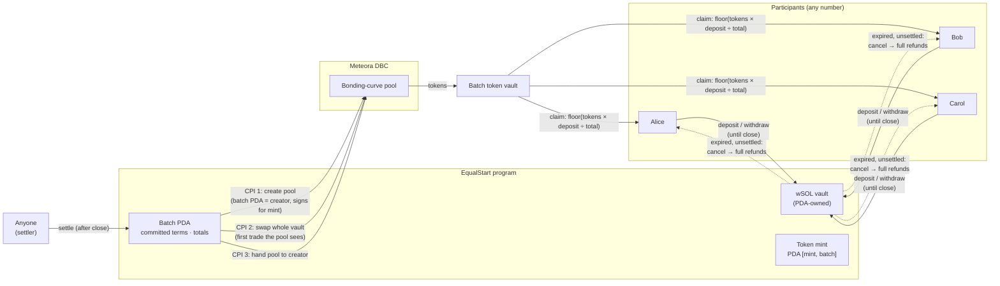

# EqualStart: submission

> Devnet only · unaudited prototype · no real funds. Any mainnet use requires independent security review first.

| | |
|---|---|
| Live app | https://equalstart.vercel.app (no wallet needed to explore) |
| Repository | https://github.com/chubbicorn245/equalstart (private for now) |
| Verification record | [`VERIFICATION.md`](VERIFICATION.md): every devnet transaction from the public run, including rejected attacks |
| Real-wallet run (Phantom, through the app) | [`evidence/ui-wallet-run.md`](evidence/ui-wallet-run.md): featured launch settled by [`3UZ6nanj…`](https://explorer.solana.com/tx/3UZ6nanjMmX5T651n5LAXMHB9rFjHyJaZw1pPUyXJjiUP2Y8Zfvst991EWU7htXvojPQpQXXr5vJTeE1HbmHPhEB?cluster=devnet) |
| Program (devnet) | [`6m6BShPDaXgQG71YSKZ2rgM9hfLVYhm3QSv3Z2TnPX1j`](https://explorer.solana.com/address/6m6BShPDaXgQG71YSKZ2rgM9hfLVYhm3QSv3Z2TnPX1j?cluster=devnet) |
| Settlement signed by an unrelated wallet | [`3mPebdq9…`](https://explorer.solana.com/tx/3mPebdq9aesrtS28sEaRJqXjMwM54BkXbotfGugknUVVQUwUdo46s2iXtubUWojGGy5VRaLnJgb2wccHSbatkN7t?cluster=devnet) (218,120 CU) |

## Architecture

**Why nobody can trade first:** the pool's mint is a PDA that only the EqualStart program can sign for. So the pool cannot exist until `settle` runs, and `settle` creates the pool and makes the batch buy inside the same instruction.

**Why settlement doesn't depend on the creator:** `settle` has no signer constraint. The creator commits the terms up front and pre-funds a small bounty for whoever settles:
- DBC config
- deadlines
- per-wallet cap
- minimum raise
- maximum opening fee
- minimum tokens per SOL

If nobody settles before expiry, anyone can cancel the launch and every participant takes a full refund.

**Checks inside `settle`:**
- the pool really was created by this instruction;
- the opening fee charged ≤ the committed ceiling, read from the pool's own fee counters;
- tokens received ≥ `floor(total × min_tokens_per_SOL)`, computed in u128;
- vault balances are correct before and after the swap.

## 90-second video script

| Time | On screen | Narration |
|---|---|---|
| 0:00–0:12 | Home page hero | "When a token launches on a bonding curve, buyers go in one after another, and every buy raises the price for the next. The first wallet in, usually a bot, gets the best price. EqualStart makes the first price everyone's price." |
| 0:12–0:27 | Comparison chart: toggle demo → 20× | "We measured this against Meteora's real bonding-curve program. Three buyers going in one after another each pay a worse price than the one before. At 20× the size, the third buyer gets about a third fewer tokens per SOL than the first. Through EqualStart, all three get exactly the same tokens per SOL." |
| 0:27–0:45 | How-it-works diagram | "Participants deposit SOL into an on-chain escrow before the token exists. The token's mint belongs to our program, so nobody can create the pool early. When deposits close, one instruction creates the Meteora pool and spends the whole batch as its very first trade. No one can get in ahead of it." |
| 0:45–1:05 | Demo launch page: progress, committed terms, then the Settle row in the activity feed → Solana Explorer | "Here's a live devnet launch. The terms are locked when the launch is created: minimum raise, wallet cap, maximum fee and minimum price. Settlement was signed by a wallet that had nothing to do with the launch. Anyone can trigger it, and they earn a small bounty. Here it is on Explorer: pool creation and the batch buy in one transaction." |
| 1:05–1:20 | Allocation bar and table, then Claim in Phantom | "Each wallet's share of the tokens equals its share of the SOL. Everyone claims independently. If a launch is never settled, anyone can cancel it after the deadline and every depositor gets a full refund." |
| 1:20–1:30 | Footer / VERIFICATION.md | "It's on devnet now, with every transaction, including rejected attacks, linked in our verification record. It's unaudited, and it needs an independent review before it goes anywhere near mainnet. EqualStart: everyone gets the first price." |
