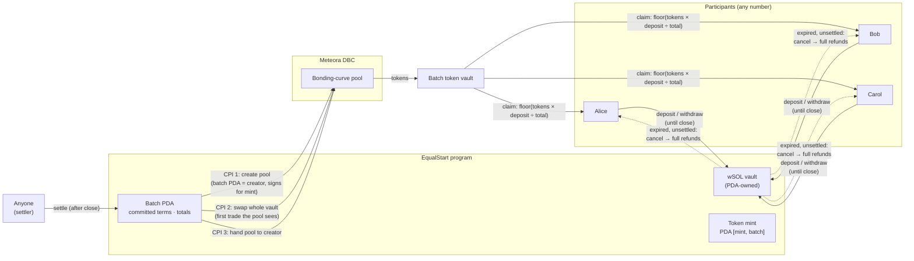

# EqualStart: submission

> Devnet only · unaudited prototype · no real funds. Any mainnet use requires independent security review first.

| | |
|---|---|
| Live app | https://equalstart.vercel.app (no wallet needed to explore) |
| Repository | https://github.com/chubbicorn245/equalstart |
| Verification record | [`VERIFICATION.md`](VERIFICATION.md): every devnet transaction from the public run, including rejected attacks |
| Real-wallet run (Phantom, through the app) | [`evidence/ui-wallet-run.md`](evidence/ui-wallet-run.md): featured launch settled by [`3UZ6nanj…`](https://explorer.solana.com/tx/3UZ6nanjMmX5T651n5LAXMHB9rFjHyJaZw1pPUyXJjiUP2Y8Zfvst991EWU7htXvojPQpQXXr5vJTeE1HbmHPhEB?cluster=devnet) |
| Program (devnet) | [`6m6BShPDaXgQG71YSKZ2rgM9hfLVYhm3QSv3Z2TnPX1j`](https://explorer.solana.com/address/6m6BShPDaXgQG71YSKZ2rgM9hfLVYhm3QSv3Z2TnPX1j?cluster=devnet) |
| Settlement signed by an unrelated wallet | [`3mPebdq9…`](https://explorer.solana.com/tx/3mPebdq9aesrtS28sEaRJqXjMwM54BkXbotfGugknUVVQUwUdo46s2iXtubUWojGGy5VRaLnJgb2wccHSbatkN7t?cluster=devnet) (218,120 CU) |

## Architecture

**Why nobody can trade first:** the pool's mint is a PDA that only the EqualStart program can sign for. So the pool cannot exist until `settle` runs, and `settle` creates the pool and makes the batch buy inside the same instruction.

**Why settlement doesn't depend on the creator:** `settle` has no signer constraint. The creator commits the terms up front and pre-funds a small bounty for whoever settles:
- DBC config
- deadlines
- per-wallet cap
- minimum raise
- maximum opening fee
- minimum tokens per SOL

If nobody settles before expiry, anyone can cancel the launch and every participant takes a full refund.

**Checks inside `settle`:**
- the pool really was created by this instruction;
- the opening fee charged ≤ the committed ceiling, read from the pool's own fee counters;
- tokens received ≥ `floor(total × min_tokens_per_SOL)`, computed in u128;
- vault balances are correct before and after the swap.

## 90-second video script

**Approach:** show the problem, the trick and the proof. Never show wallet switching on screen.
- Record the narration first, then cut the screen footage to fit it.
- Narration is about 205 words, which is a comfortable pace for 90 seconds.
- Burn in captions, since many judges watch muted.

**Before recording:**
- Use a browser window of about 1280×800, with the bookmarks bar hidden.
- Open the race at https://equalstart.vercel.app/#/race. It plays on load; press **R** to replay it.
- For the deposit montage, set up three Chrome profiles, each with Phantom on one account, and tile them side by side.

| Time | On screen | Narration (words) |
|---|---|---|
| 0:00–0:10 | `#/race` playing: three orange bars land one after another; caption "Going first was worth 51% more tokens per SOL" | "Three people buy the same new token, one after another. The first one gets fifty-one percent more tokens per SOL than the last. Just for being first." (27) |
| 0:10–0:16 | Same shot: the bars collapse into one green level at 24.3M each | "EqualStart turns all three buys into one. Same price for everyone." (11) |
| 0:16–0:22 | Home page hero, slow zoom on "Everyone gets the first price." | "On a real launch, first in line is usually a bot. We remove the line." (14) |
| 0:22–0:37 | How-it-works diagram, highlighting each step as it's named | "Buyers deposit SOL into an on-chain escrow before the token exists. Our program owns the token's mint, so nobody can create the pool early. When deposits close, one instruction creates the Meteora pool and makes the whole batch its very first trade." (43) |
| 0:37–0:45 | Three tiled browser windows, each depositing at 4× speed, with captions "0.3 SOL", "0.2 SOL", "0.1 SOL" | "Here it is live on devnet. Three wallets, three deposits, one batch." (12) |
| 0:45–1:05 | Solana Explorer, [settle tx `3UZ6nanj…`](https://explorer.solana.com/tx/3UZ6nanjMmX5T651n5LAXMHB9rFjHyJaZw1pPUyXJjiUP2Y8Zfvst991EWU7htXvojPQpQXXr5vJTeE1HbmHPhEB?cluster=devnet): zoom on the Meteora DBC program address `dbcij3…SMaqN` (caption: "Meteora DBC: same program ID as mainnet"), then the signer, then the inner Meteora instructions (pool creation, then the swap) | "This is Meteora's own bonding-curve program, the same one used on mainnet, not a mock. Settlement was signed by a wallet that never deposited. Anyone can press the button and earn a small bounty. Inside one transaction, the pool is born and the batch buys. Nothing gets in between." (49) |
| 1:05–1:17 | Demo launch page: the allocation bar and table, every row "claimed" | "Each wallet's share of the tokens matches its share of the SOL, to the smallest unit. If nobody settles in time, everyone gets a full refund." (27) |
| 1:17–1:30 | VERIFICATION.md scrolling, then the logo and URL | "Every transaction, including rejected attacks, is in our verification record. It's unaudited and devnet only for now. EqualStart: everyone gets the first price." (24) |
